<!-- Generated from docs/src/en_US/pages/modules.doc by scripts/yume_docs.py. Edit that file, not this one. -->
# YUME modules

A module is a program that serves one of the daemon's stream services. A
service manager runs it with a listening UNIX socket, and `yumed` connects to
that socket once for each authorized stream of the service. A module needs no
network port and no YUME library, and `yumed` never starts it.
Only the daemon uses modules so far. Client-side modules are planned.

## Configure a module

Declare a stream service in the server configuration and give it a `module`
adapter that names the module's socket:

```json
{
  "kind": "module",
  "service": "echo",
  "socket": "/run/yume-modules/echo.sock"
}
```

`socket` is an absolute, normalized path of at most 107 bytes. On the server
a stream service has one adapter, so a service with a module has no
`direct_tcp` adapter. Identities reach the service through their grants as
usual, such as `{"service": "echo", "kind": "stream"}` in an authorized-keys
entry.

`yumed --validate` and daemon startup refuse a socket that another user could
reach or replace. The socket must be a UNIX socket that belongs to the
daemon's user with no group or other permission, in a real directory, not a
symbolic link, owned by root or the daemon's user and closed to writes by
group and others. A missing socket also fails, so start the module's socket
before the daemon. Each connection then checks that root or the daemon's
user created the listener, so a socket another user puts in its place later
receives no stream. SIGHUP reloads credential stores only, so a changed module
adapter takes effect when `yumed` restarts.

A client reaches the module through any adapter that opens the stream service
without a destination, such as a `forward` adapter:

```json
{"kind": "forward", "service": "echo", "listen_path": "/run/user/1000/yume/echo.sock"}
```

The daemon refuses a stream that names a destination.

## Run a module with systemd

The Debian package ships two templates, `yume-module@.socket` and
`yume-module@.service`, whose instance is the service name. For the `echo`
service:

```bash
sudo install -D -o root -g root -m 0755 build/bin/yume-echo-module \
  /usr/libexec/yume/modules/echo
sudo systemctl enable --now yume-module@echo.socket
sudo systemctl restart yumed
```

The socket unit creates `/run/yume-modules/echo.sock` for the `yume` user
with mode 0600, in a root-owned directory, and keeps it open while the module
starts, stops and restarts. The first connection starts
`yume-module@echo.service`, which runs `/usr/libexec/yume/modules/echo` with
the socket as descriptor 3. To run a program from another path, give the
service a drop-in with `systemctl edit yume-module@echo.service`:

```ini
[Service]
ExecStart=
ExecStart=/usr/local/libexec/yume/yume-echo-module --quiet
```

The service runs the module as a dynamic user of its own with no
capabilities, no new privileges, a read-only system, no access to
`/etc/yume`, `/var/lib/yume`, `/var/log/yume` or `/run/yume`, a private
`/tmp` and a state directory below `/var/lib/yume-modules`. It has no network.
A module that needs one, such as a codec backend, sets `PrivateNetwork=false`
and its address families in a drop-in. systemd starts a module that failed
again after one second.

On a host without systemd, any supervisor that passes a listening socket as
descriptor 3 can run a module. For development,
`systemd-socket-activate` does it without a unit:

```bash
mkdir -m 0700 -p "$XDG_RUNTIME_DIR/yume"
(umask 077 && systemd-socket-activate -l "$XDG_RUNTIME_DIR/yume/echo.sock" \
  build/bin/yume-echo-module)
```

## What the program receives

The module starts with descriptor 3, a listening UNIX stream socket to accept
connections from, and whatever else its service manager gives it. Under the
packaged unit that is descriptor 0 reading `/dev/null`, descriptors 1 and 2
connected to the journal, and the `LISTEN_FDS` variables of socket
activation.

## Streams

Each authorized stream of the service arrives as one connection. Before the
stream's bytes, the daemon writes one line:

```text
yume-module 1 <identity> <service>
```

`identity` is the client's composite key fingerprint, the 64 lowercase
hexadecimal digits recorded as `sha256` in its authorized-keys entry.
`service` is the service name, and a newline ends the line. After it, the
connection carries the stream in both directions. When the client closes its
sending side, the module reads end of file and can still reply. When the
module shuts down its sending side, the client reads end of file, and closing
the connection ends the stream. A module that finds a version other than 1
should close the connection.

The client's stream opens once the connection is made and the line is
written, so stream bytes can follow the line at once. The connection waits
in the socket's queue until the module accepts it, so a stream opened while
the module restarts reaches the next run. Connecting and writing the line
must finish within 10 seconds. A socket that is gone or whose queue is full
refuses the stream, and one module receives at most 1024 connections at once.

<!-- yume-diagram: module_bridge -->


<details>
<summary>What each part does</summary>

- **Client**: Opens a configured byte-stream service without a destination, for example through a local forward or the C ABI. ([`src/runtime/native_forward.cpp`](../src/runtime/native_forward.cpp), [`src/abi/native_backend.cpp`](../src/abi/native_backend.cpp))
- **yumed**: Checks the authenticated identity's service grant before handing the stream to its module adapter. ([`src/runtime/native_endpoint.cpp`](../src/runtime/native_endpoint.cpp), [`src/runtime/native_credentials.cpp`](../src/runtime/native_credentials.cpp))
- **Module bridge**: Connects to the module's socket, which only the daemon's user can reach, and writes the version, identity and service header before the stream bytes. It preserves both half-closes. ([`src/runtime/module_connector.cpp`](../src/runtime/module_connector.cpp))
- **Module program**: Accepts the connection and serves it without linking YUME. systemd runs it as a user of its own with the socket as descriptor 3, so it cannot read the daemon's credential files. ([`src/modules/echo/echo_module.cpp`](../src/modules/echo/echo_module.cpp))

</details>

<details>
<summary>Text version</summary>

```text
+--------------------------+
|  Client                  |
|  OPEN named service      |
+-------------+------------+
              |
              v ==YUME==> service OPEN and DATA
+-------------+------------+
|  yumed                   |
|  identity grant first    |
+-------------+------------+
              |
              v authorized stream
+-------------+------------+
|  Module bridge           |
|  private UNIX connection |
+-------------+------------+
              |
              v header, then bytes
+-------------+------------+
|  Module program          |
|  accepts on descriptor 3 |
+--------------------------+
```

</details>
<!-- /yume-diagram -->

## Restarts and stopping

When the module exits, its connections close and their streams end. Its
service manager decides whether and when it starts again, while the socket
stays open. Stopping `yumed` ends the streams it carries and leaves the module
running. Stopping the socket unit with `RemoveOnStop` removes the socket, and
the daemon then refuses the module's streams until it is back.

## Trust

The daemon checks each identity's grant before a stream reaches the module.
The header can be trusted because only the daemon's user and root can connect
to the socket. Under the packaged unit the module runs as its own dynamic
user, so it cannot read the server's configuration or credential files, which
belong to `yume`, and cannot connect to another module's socket. It still
receives the client's identity and stream bytes, so it sees what the client
sends to that service. A module run by another supervisor is only as isolated
as that supervisor makes it.

## Write a module

`src/modules/echo/echo_module.cpp` is a complete module of under 100 lines. It
accepts connections on descriptor 3, reads the header line, greets the client
by identity and echoes the stream back. Any program that can accept
connections on an inherited UNIX socket can be a module. Read the header up to
its newline without discarding what follows, since stream bytes can arrive in
the same read. Exit promptly on SIGTERM. The daemon bounds how many streams
reach a module, while the module bounds its own work on each one.
